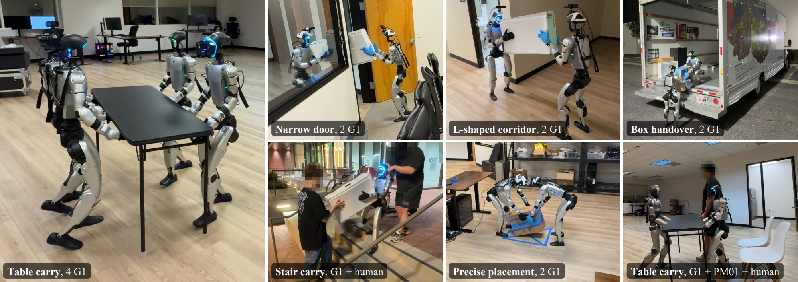
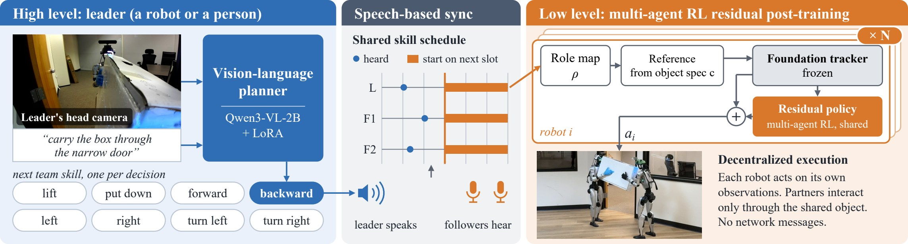

<h1 align="center">Heave-Ho: Decentralized Long-Horizon Multi-Humanoid Collaboration</h1>

  <a href="https://koi953215.github.io/">Ting-Hsuan Chen</a>1*&nbsp;&nbsp;
  <a href="https://sihengz02.github.io/">Siheng Zhao</a>1*&Dagger;&nbsp;&nbsp;
  <a href="https://hanjiang.site/">Han Jiang</a>1*&nbsp;&nbsp;
  <a href="https://www.linkedin.com/in/qi-pan-179050384/">Qi Pan</a>1&nbsp;&nbsp;
  <a href="https://www.linkedin.com/in/louisonlu/">Louison Lu</a>1
   
  <a href="https://kb-jiaheng.github.io/about/">Jiaheng Luo</a>1&nbsp;&nbsp;
  <a href="https://henghuib.github.io/">Henghui Bao</a>1&nbsp;&nbsp;
  <a href="https://openreview.net/profile?id=%7EYiyu_Chen4">Yiyu Chen</a>2&nbsp;&nbsp;
  <a href="https://www.linkedin.com/in/qtn/">Quan Nguyen</a>1&nbsp;&nbsp;
  <a href="https://yuewang.xyz/">Yue Wang</a>1&dagger;

  1University of Southern California&nbsp;&nbsp;&nbsp;2VinMotion
   
  *Equal contribution&nbsp;&nbsp;&nbsp;&dagger;Corresponding author&nbsp;&nbsp;&nbsp;&Dagger;Project lead

  
  
  

  

> [!NOTE]
> **Code release:** we plan to release the code by the end of December 2026. Watch or star this repository to get notified.
> In the meantime, videos of all real-world and simulated experiments are on the [project page](https://heaveho-humanoid.github.io/).

## Abstract

Collaboration promises to extend humanoid capabilities beyond what individual robots can achieve. However, realizing this potential requires coordinated whole-body interactions, coherent long-horizon planning, and precise synchronization across robots. We introduce **Heave-Ho**, a decentralized framework for long-horizon collaborative multi-humanoid loco-manipulation. At the low level, we develop a multi-agent post-training framework that adapts a humanoid foundation tracking model to physically coupled interactions between humanoids, enabling coordinated decentralized control from local observations alone. At the high level, we train a vision-language planner and design a speech-based leader-follower coordination mechanism to synchronize decentralized execution without network communication. Trained with two identical humanoids, our system scales to teams of up to ten robots and generalizes to heterogeneous teams without retraining. To benchmark these capabilities, we introduce **HH-Bench**, comprising 12 tasks involving teams of 2 to 10 humanoids, including heterogeneous teams. Systematic evaluations show that Heave-Ho consistently outperforms baseline methods, while real-world experiments demonstrate robust decentralized collaboration across challenging tasks.

## Overview

  

At the high level, the leader's vision-language planner selects the next team skill from its camera and speaks it; every follower recognizes the command on board, and all robots start it on a shared skill schedule. At the low level, each robot maps the team skill to its own role, generates a reference conditioned on the object specification, and tracks it with a frozen foundation tracking model plus a residual policy shared by all robots. No network message is exchanged between robots.

## Citation

A BibTeX entry will be added here once the paper is on arXiv.
